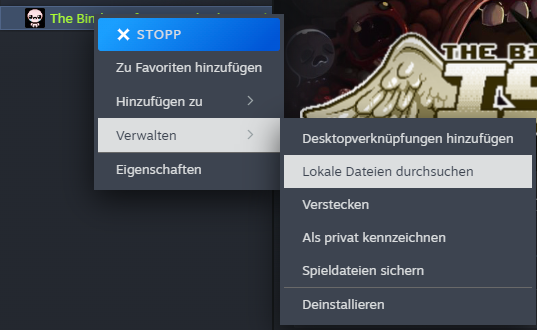
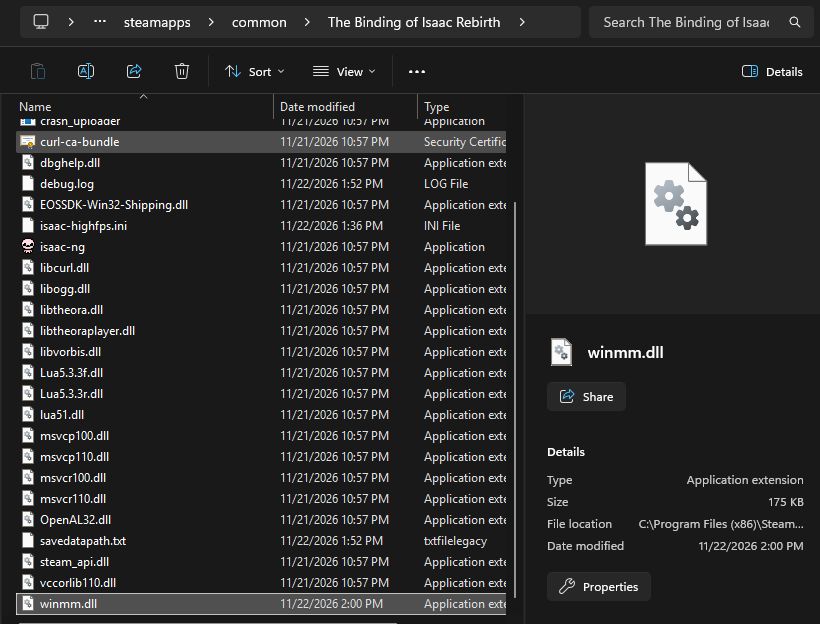

# isaac-highfps

Runs The Binding of Isaac: Rebirth (Repentance+) at your display's refresh rate.

The game is locked to 60 FPS. This mod removes the lock and gives the extra frames real
in-between positions, so movement is smooth at 120, 144, 165 or 240 Hz. Game speed, timing and
seeds do not change.

**[Download the latest release](https://github.com/hunchcldev/isaac-highfps/releases/latest)**

This is a beta. If something stutters or looks wrong, please
[open an issue](https://github.com/hunchcldev/isaac-highfps/issues) and attach the log file
(see [Problems](#problems)).

## What you need

- The game on Steam, up to date (v1.9.7.19). The version before it (v1.9.7.17) and the
  REPENTOGON copy (v1.9.7.12) work too.
- Windows. For Steam Deck and Linux see [below](#steam-deck-and-linux).
- A display that runs above 60 Hz.

## Install

1. Download the zip from the
   [Releases page](https://github.com/hunchcldev/isaac-highfps/releases/latest) and unzip it.
   The only file you need is `winmm.dll`. If your browser or antivirus blocks the download,
   see [Antivirus warnings](#antivirus-warnings).

2. Open the game's folder. In Steam, right-click *The Binding of Isaac: Rebirth* in your
   Library, then **Manage → Browse local files**. The picture shows a German Steam, where
   that reads *Verwalten → Lokale Dateien durchsuchen*.

   

3. Copy `winmm.dll` into the folder that opens, next to `isaac-ng.exe`. Not into `mods` and
   not into a subfolder.

   

4. Start the game from Steam as usual.

To uninstall, delete `winmm.dll`.

## Check that it works

Pick one:

- Subscribe to the
  [High FPS Workshop item](https://steamcommunity.com/sharedfiles/filedetails/?id=3776277093).
  It shows "High FPS active" for a few seconds when a run starts.
- Copy `isaac-highfps.ini` from the zip next to the DLL and set `ShowFps = 1`. The frame rate
  is then shown at the top of the screen.

While the game is paused, or in a menu where nothing moves, the rate drops to 60. That is
intended.

The Workshop item does not add frames by itself. The Workshop can only carry Lua mods, and a
Lua mod cannot change the frame rate, so the item only reports what the DLL is doing.

## Problems

| What you see | What it means | What to do |
|---|---|---|
| "High FPS x.y.z is out" | It works, but a newer release exists | Install the latest release |
| "High FPS needs an update for this game version" | The DLL does not know your game version and has changed nothing | Install the latest release |
| "High FPS is not installed" | No DLL was found | Check that `winmm.dll` is next to `isaac-ng.exe` and that your antivirus has not removed it |
| The game closes right after starting | A release older than v0.14.0 on the current game version | Delete `winmm.dll`, install the latest release |
| Nothing changes and there is no log file | Windows did not load the DLL | Check the folder, then try [the second file name](#if-windows-does-not-load-the-dll) |
| There is a log file but the game stays at 60 | The display runs at 60 Hz, or a cap is set | Check the refresh rate in Windows display settings and `MaxFps` in the ini |
| The download is blocked or the file disappears | Your browser or antivirus stepped in | See [Antivirus warnings](#antivirus-warnings) |

The log file is `%TEMP%\isaac-highfps.log`. Press `Win + R`, paste that and press Enter.
Attach it when you report a problem.

### If Windows does not load the DLL

On a few systems `winmm.dll` is not picked up. The zip has the same mod under a second name,
`alternative-name\dbghelp.dll`:

1. Delete `winmm.dll` from the game folder.
2. The game folder already has a `dbghelp.dll` of its own. Rename it to `dbghelp.dll.bak`.
3. Copy `dbghelp.dll` from `alternative-name\` into the game folder.

To undo this, delete the copied file and rename the original back. Use one of the two names,
never both.

## REPENTOGON

The REPENTOGON launcher runs its own copy of the game from the `Repentogon` subfolder. For
REPENTOGON the DLL goes next to that `isaac-ng.exe`:

```
The Binding of Isaac Rebirth\Repentogon\winmm.dll
```

You can have the DLL in both folders at once.

- Do not put v0.13.0 or older there. The launcher then fails with
  `Unable to kill Isaac process: 5`.
- Use `winmm.dll` there, not the `dbghelp.dll` alternative.
- Other mods' drawing code runs at the display rate on that copy of the game (see
  [Mods](#mods)). Most mods do not care. A menu that repeats while you hold a key repeats
  faster.

## Steam Deck and Linux

It works under Proton with one extra step. Wine prefers its own `winmm` over the one in the
game folder, so add this launch option (right-click the game, **Properties**, *Launch Options*):

```
WINEDLLOVERRIDES="winmm=n,b" %command%
```

The Deck's LCD runs at 60 Hz, so the mod has nothing to show there. It helps on the OLED model
at 90 Hz and on an external screen. If the game crashes, set `LuaOverlay = 0` in the ini.

## Antivirus warnings

Some browsers block the download, and Microsoft Defender has removed the zip as
`Trojan:Script/Wacatac.H!ml`. That is a false positive. Scanners flag the file for three
reasons:

- It is named like a Windows system file. That is how it gets loaded by the game without an
  installer, and malware uses the same method.
- It changes the game's code in memory. Removing the 60 FPS lock is not possible otherwise.
- It is not signed and few people have it. A name ending in `!ml` means a statistical model
  found the file unusual, not that it matched known malware.

The mod reads its ini, writes its log and changes the game while it runs. It does not go
online and does not touch other programs. The full source is in this repository and
`build.bat` builds the DLL from it.

What to do:

- Only download from the Releases page of this repository.
- If Defender removed the file, open *Windows Security → Virus & threat protection →
  Protection history*, select the entry and choose *Restore*.
- To keep it from happening again, add an exclusion for the file `winmm.dll` in your game
  folder under *Virus & threat protection settings → Exclusions*. Exclude the file, not the
  folder.

## Settings

Settings are optional. Copy `isaac-highfps.ini` from the zip next to the DLL. The ones most
people need:

| Setting | Default | What it does |
|---|---|---|
| `ShowFps` | 0 | 1 shows the frame rate at the top of the screen |
| `MaxFps` | 0 | Caps the frame rate, for example 120. 0 means no cap |
| `Interpolate` | 1 | 0 gives more frames but no in-between positions |
| `Enabled` | 1 | 0 switches the mod off without deleting it |

The ini file explains every other setting.

## Mods

Other mods keep working. Mods expect their drawing code to run 60 times a second, so this mod
keeps running it 60 times a second and shows what they drew on every frame in between.

If a mod flickers or misbehaves only with this installed, set `LuaVanillaCadence = 0`. If the
game crashes while mods are drawing, set `LuaOverlay = 0`.

Mod authors: the globals the DLL publishes are described in
[docs/HOW-IT-WORKS.md](docs/HOW-IT-WORKS.md#for-mod-authors).

## How it works

Three changes are made to the running game in memory. No file is modified.

1. The 60 FPS limiter is switched off.
2. The game's logic gets its own clock, so it keeps its original speed.
3. For the frames in between, every moving thing is placed where it would be at that moment.

Before anything is changed, every place the mod is about to touch is compared with what it
expects to find. If one of them does not match, for example on a game version it does not
know, nothing is changed and the game runs as usual.

Details are in [docs/HOW-IT-WORKS.md](docs/HOW-IT-WORKS.md).

## Building

You need MSVC (x86) and Python 3.

```
build.bat
```

This produces `build\winmm.dll`.

## Credits and licence

MIT, see `LICENSE`.

Thanks to the REPENTOGON team. Their published function signatures helped to put names to
functions in the game. No REPENTOGON code is used.
